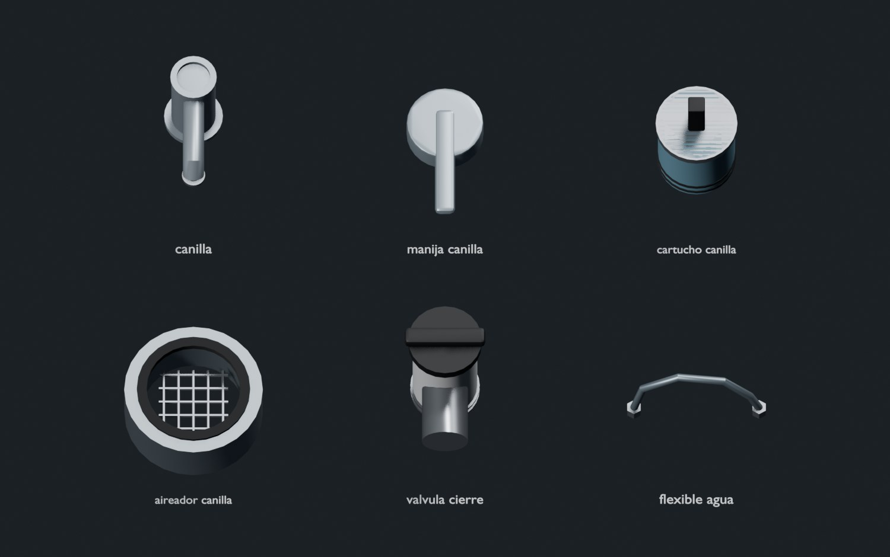
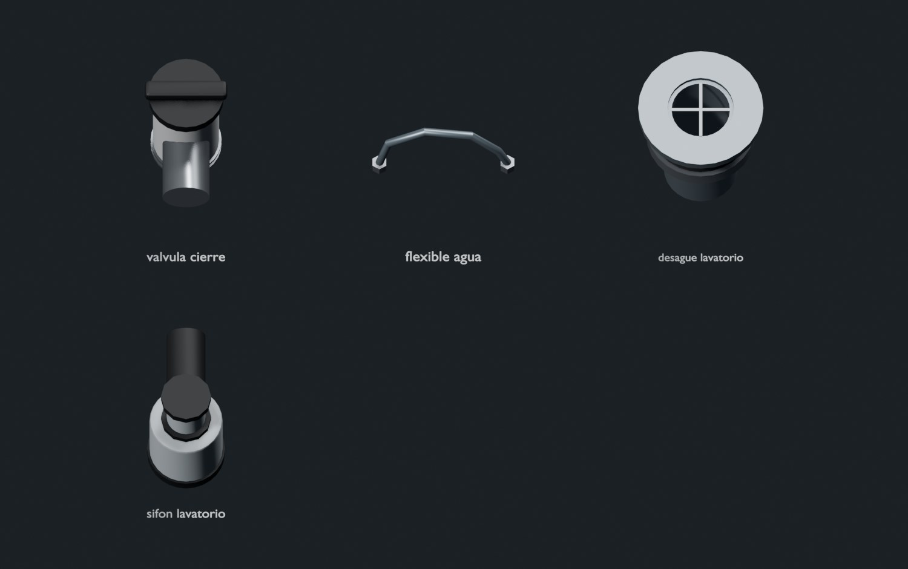
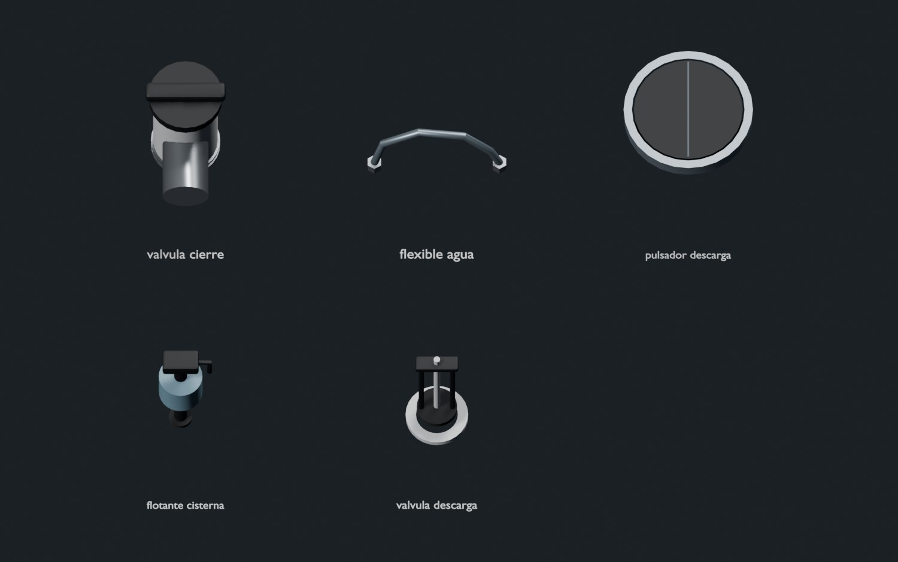
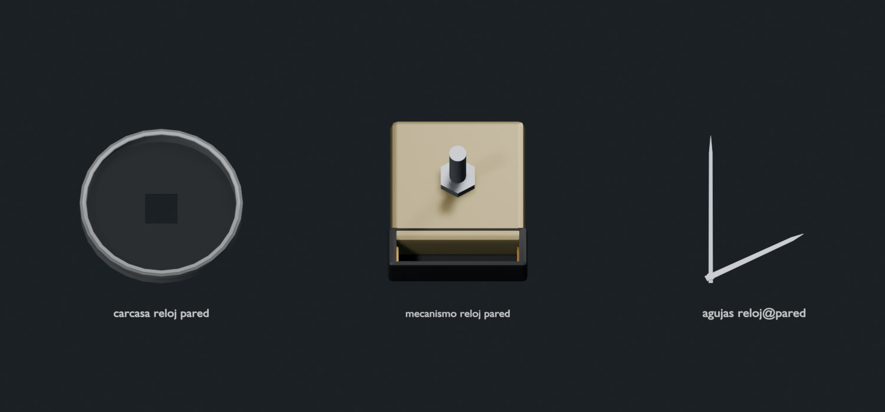
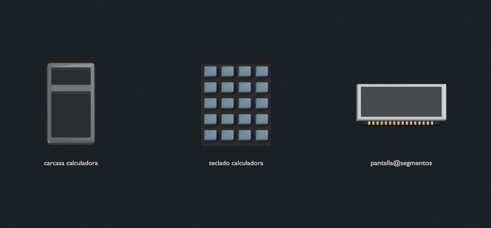
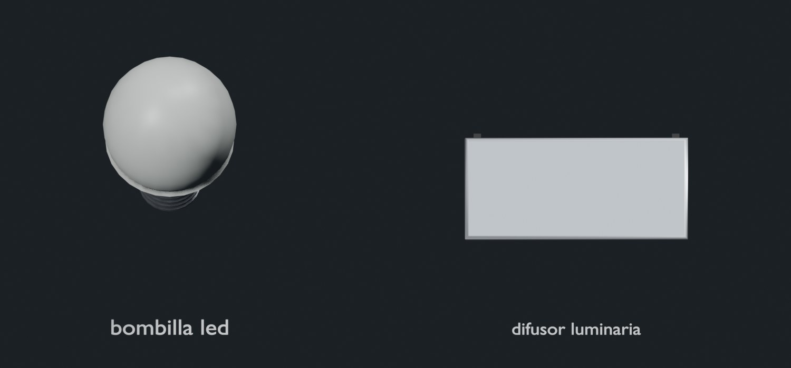
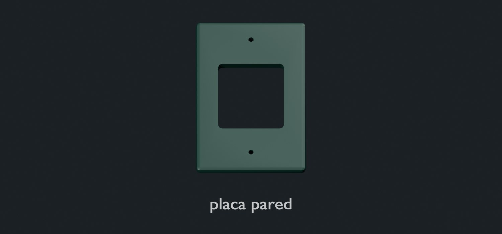
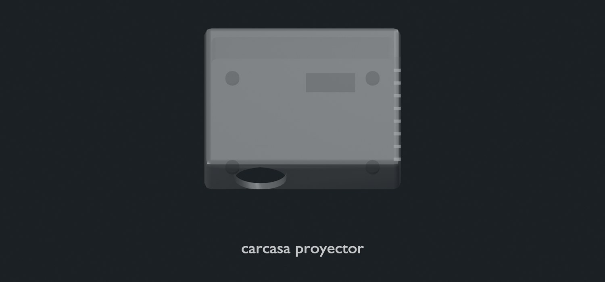

# Objetos a mano en la facultad

Familia independiente `campus.glb`: **21 formas nuevas**, para completar lo que un jurado puede encontrar cerca. No reemplaza tipos ni recetas anteriores. La biblioteca total conserva 212 formas de main y suma estas 21: **233**.

- Canilla y baño: cuerpo monocomando, manija, cartucho, aireador, llave de paso, flexible, desagüe, sifón, pulsador, flotante y válvula de descarga.
- Reloj de pared: caja, movimiento de cuarzo y agujas largas (`agujas_reloj@pared`). Reutiliza esfera, pila AA y tornillos.
- Aula: placa de pared, bombilla LED, difusor de luminaria, carcasa de calculadora, teclado, pantalla de segmentos y carcasa de proyector. Reutiliza fuente, conectores, tiras LED, placa, pila, lente y módulos de proyección.

[Cobertura exacta, incluyendo tipos reutilizados](campus-cobertura.json). Cada tipo tiene regla explícita de AJUSTES, material, descripción y palabras de equipo. Los tipos redondos conservan su sección; las agujas usan escala proporcional.

## Revisión visual

Hay además un JPG por cada forma en `renders/campus`. Los renders se obtienen decodificando el GLB publicado: muestran su geometría simplificada y las recetas del visor.

## Ensayo interactivo

Con `NEXT_PUBLIC_DATOS=fixture npm run dev`, abrir `/lab/campus`. Hay **31 ejemplos**: notebooks, MacBook Air/Pro, celulares genéricos tipo iPhone/Samsung, TV, heladera, split, lavarropas, impresora, router, smartwatch, reloj de pulsera, reloj de pared, baño, calculadora, proyector, luminaria y toma de pared. También incluye tablet, auriculares, mouse, teclado, joystick, parlante bluetooth, cargador, control remoto y batería externa reutilizados de main. Se puede girar, despiezar y armar.

Son esquemas ilustrativos exclusivos del lab. No confirman disposición, compatibilidad, repuestos ni procedimientos de un equipo real. Los MacBook de prueba usan placa integrada y celdas adheridas; Air no lleva ventilador y ninguno tiene RAM/SSD removibles.

## Regeneración

Publicar con `npm run modelos:demo`, que conserva las otras familias. Para editar solo esta fuente, usar Blender con `campus.py -- --salida <carpeta-cruda>`; después publicar mediante el comando completo. Ver [revisión y formato](CALIDAD_DEMO.md).
