# Familia independiente: pequeños electrodomésticos y wearables

52 formas nuevas para 13 equipos, en `public/models/piezas/cotidianos.glb` (menos de 2 MB).
IDs por tipo, nodos independientes y animables, centímetros y materiales del visor.
La lista de nuevas piezas y referencias reutilizadas está en `cotidianos-cobertura.json`;
es un inventario de cobertura para revisión y tests, no un plano de un modelo comercial.

## Regenerar

```sh
npm run modelos:cotidianos
npm run modelos:cotidianos -- --renders assets/models/blender/renders/cotidianos
npm run modelos:cotidianos -- --renders assets/models/blender/renders/cotidianos --render-piezas carcasa_auricular
```

Requiere Blender 4.2+ en PATH. No usa APIs, claves ni servicios pagos. El script reutiliza
las primitivas y el cierre de materiales existentes sin ejecutar sus generadores.
Solo escribe su GLB y sus entradas del índice; conserva familias ajenas y rechaza colisiones.
Las hojas por equipo muestran las piezas nuevas; los IDs reutilizados se enumeran debajo.
Incluye 52 renders individuales y 13 hojas. Las piezas de cada hoja se normalizan para poder
compararlas: esa vista no representa su tamaño relativo, un montaje ni un despiece real.

## Revisar los GLB finales comprimidos

Los renders de las familias nuevas se revisaron después de comprimir, usando
`decodificar.mts` para reconstruir las recetas reales del visor. No son capturas
del producto: la auditoría de cámara, etiquetas y coreografía en iPhone sigue aparte.

```sh
node --import tsx assets/models/blender/decodificar.mts public/models/piezas /tmp/sayso-revision
blender -b --factory-startup --python-exit-code 1 --python assets/models/blender/revisar_publicados.py -- --script notebook_demo.py --glb /tmp/sayso-revision/notebook_demo.glb --renders assets/models/blender/renders/notebook_demo
```

Cambiar script y GLB por la familia a revisar. Sin APIs, credenciales ni costo de IA.

## Reglas de forma y materiales

Cada pieza nueva tiene regla explícita en `AJUSTES` de `piezas.py`, exportada al índice y a
`extras.ajuste` del GLB. Ejes del GLB: X, Z y -Y de Blender. Aros conservan su sección;
fusible y columna telescópica ajustan el tramo; conectores y conjuntos asimétricos se escalan
proporcionalmente; rejillas rectangulares y membranas permiten escala libre.

`correa_reloj` es una pulsera, diferenciada de `correa` de transmisión. `pila_aa` distingue
la celda cilíndrica de `pila`, que ya es una pila de botón. `pantalla@reloj` agrega una forma
circular a las variantes de pantalla; no reemplaza las existentes. Motor, resistencia,
termostato, baterías, conectores y parlantes se reutilizan por sus nombres del índice.
Las recetas nuevas están al final de `RECETAS`, después de las de dispositivos, conservando
la prioridad de todos los prefijos existentes.

Son ilustraciones genéricas por tipo. No certifican compatibilidad, norma de clavija,
especificaciones eléctricas, circuitos funcionales ni dimensiones para fabricar repuestos.
Las piezas del microondas solo amplían la representación visual; no agregan instrucciones
de reparación ni modifican las validaciones de seguridad del producto.

## Verificar

```sh
python3 assets/models/blender/test_indice.py
npm test
npm run typecheck
npm run build
```

Los tests comprueban cobertura, reutilización, carga a demanda, tamaño y correspondencia
GLB/índice, reglas de ajuste, renders, materiales, normales y posiciones finitas y nodos
animables. La suite general verifica que las reglas redondas conserven la forma.

## Galería y cobertura

### Air fryer

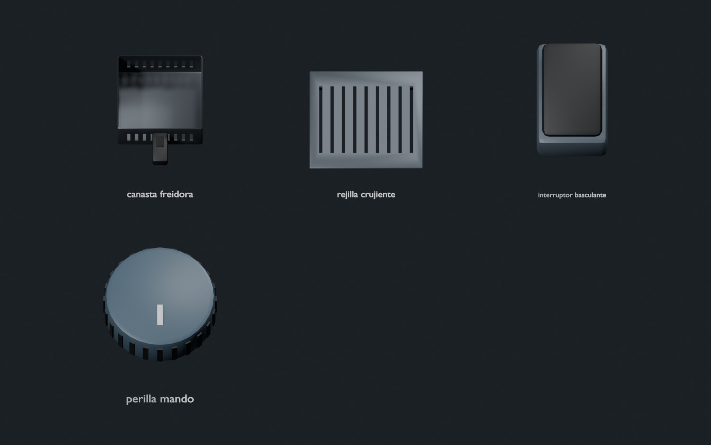

Nuevas:

- [canasta_freidora](renders/cotidianos/canasta_freidora.jpg) — `libre`.
- [rejilla_crujiente](renders/cotidianos/rejilla_crujiente.jpg) — `libre`.
- [interruptor_basculante](renders/cotidianos/interruptor_basculante.jpg) — `proporcional`.
- [perilla_mando](renders/cotidianos/perilla_mando.jpg) — `redondo:xz`.

Reutilizadas: `resistencia`, `termostato`, `ventilador`, `motor`, `panel`, `fuente`, `tornillo`.

### Licuadora

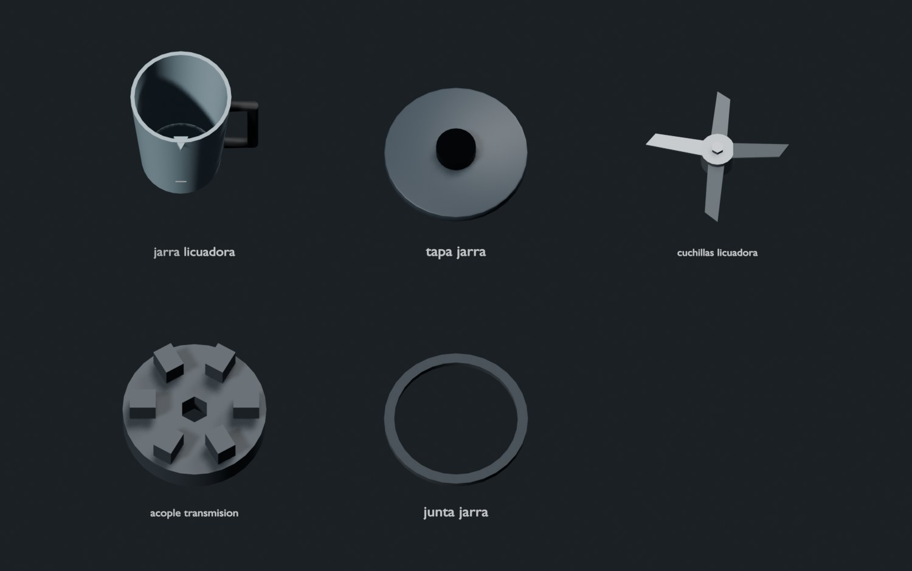

Nuevas:

- [jarra_licuadora](renders/cotidianos/jarra_licuadora.jpg) — `proporcional`.
- [tapa_jarra](renders/cotidianos/tapa_jarra.jpg) — `redondo:xz`.
- [cuchillas_licuadora](renders/cotidianos/cuchillas_licuadora.jpg) — `proporcional`.
- [acople_transmision](renders/cotidianos/acople_transmision.jpg) — `redondo:xz`.
- [junta_jarra](renders/cotidianos/junta_jarra.jpg) — `redondo:xz`.

Reutilizadas: `motor`, `selector_deslizante`, `placa@control`, `cable@redondo`, `tornillo`.

### Tostadora

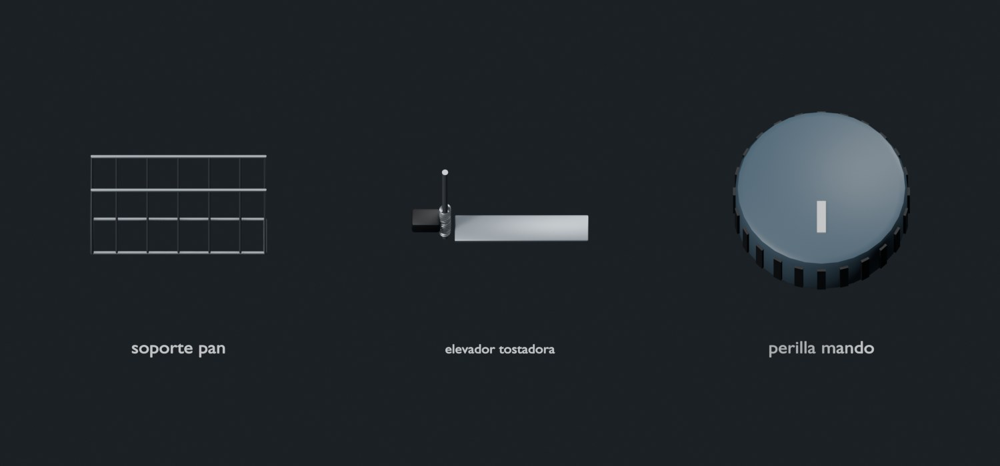

Nuevas:

- [soporte_pan](renders/cotidianos/soporte_pan.jpg) — `proporcional`.
- [elevador_tostadora](renders/cotidianos/elevador_tostadora.jpg) — `proporcional`.
- [perilla_mando](renders/cotidianos/perilla_mando.jpg) — `redondo:xz`.

Reutilizadas: `resistencia`, `soporte_mica`, `termostato`, `bandeja@goteo`, `cable@redondo`.

### Pava eléctrica

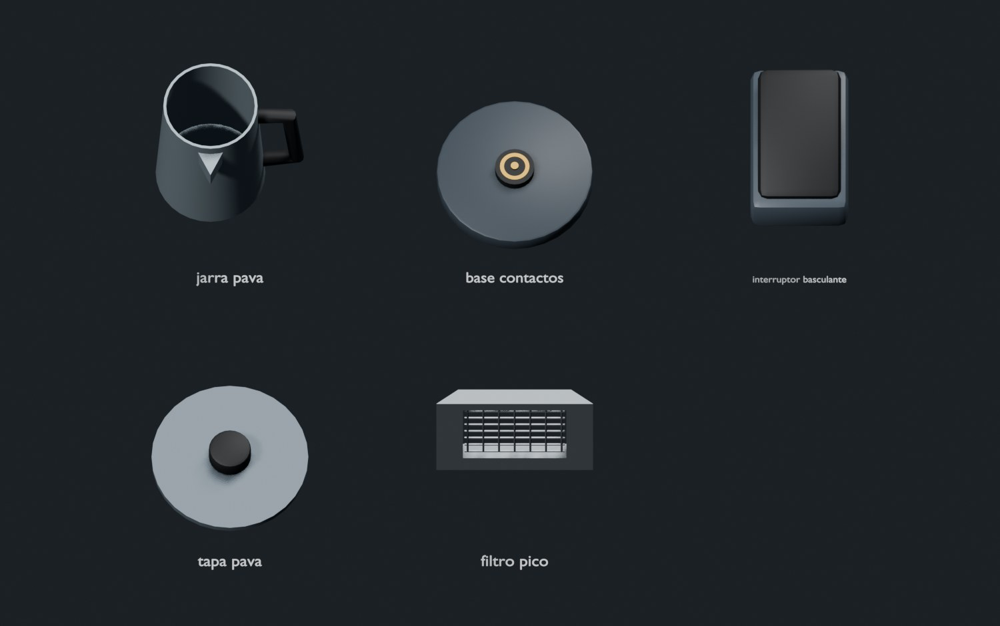

Nuevas:

- [jarra_pava](renders/cotidianos/jarra_pava.jpg) — `proporcional`.
- [base_contactos](renders/cotidianos/base_contactos.jpg) — `redondo:xz`.
- [interruptor_basculante](renders/cotidianos/interruptor_basculante.jpg) — `proporcional`.
- [tapa_pava](renders/cotidianos/tapa_pava.jpg) — `redondo:xz`.
- [filtro_pico](renders/cotidianos/filtro_pico.jpg) — `proporcional`.

Reutilizadas: `resistencia`, `termostato`, `cable@redondo`, `tornillo`.

### Microondas

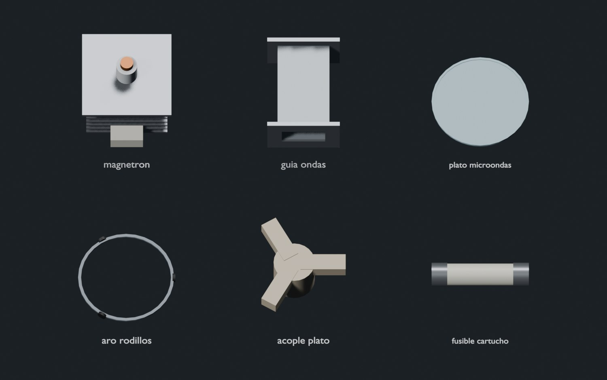

Nuevas:

- [magnetron](renders/cotidianos/magnetron.jpg) — `proporcional`.
- [guia_ondas](renders/cotidianos/guia_ondas.jpg) — `proporcional`.
- [plato_microondas](renders/cotidianos/plato_microondas.jpg) — `redondo:xz`.
- [aro_rodillos](renders/cotidianos/aro_rodillos.jpg) — `redondo:xz`.
- [acople_plato](renders/cotidianos/acople_plato.jpg) — `proporcional`.
- [fusible_cartucho](renders/cotidianos/fusible_cartucho.jpg) — `tramo:x:redondo`.

Reutilizadas: `carcasa@microondas`, `capacitor`, `transformador`, `motor`, `ventilador`, `panel`, `puerta`, `soporte_mica`, `conector@terminal`.

### Plancha

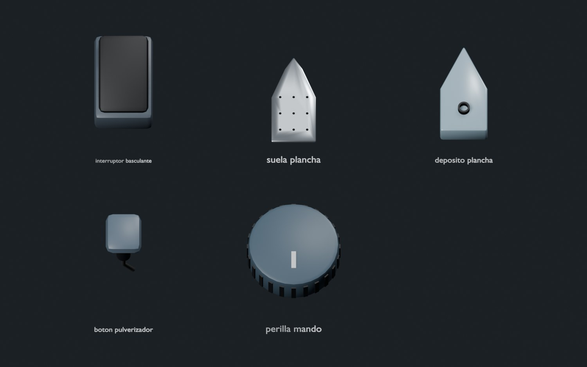

Nuevas:

- [interruptor_basculante](renders/cotidianos/interruptor_basculante.jpg) — `proporcional`.
- [suela_plancha](renders/cotidianos/suela_plancha.jpg) — `proporcional`.
- [deposito_plancha](renders/cotidianos/deposito_plancha.jpg) — `proporcional`.
- [boton_pulverizador](renders/cotidianos/boton_pulverizador.jpg) — `proporcional`.
- [perilla_mando](renders/cotidianos/perilla_mando.jpg) — `redondo:xz`.

Reutilizadas: `resistencia`, `termostato`, `cable@redondo`, `tornillo`.

### Ventilador de pie

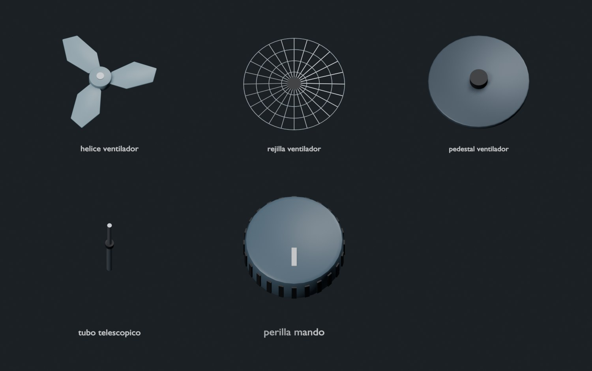

Nuevas:

- [helice_ventilador](renders/cotidianos/helice_ventilador.jpg) — `proporcional`.
- [rejilla_ventilador](renders/cotidianos/rejilla_ventilador.jpg) — `redondo:xz`.
- [pedestal_ventilador](renders/cotidianos/pedestal_ventilador.jpg) — `redondo:xz`.
- [tubo_telescopico](renders/cotidianos/tubo_telescopico.jpg) — `tramo:y:redondo`.
- [perilla_mando](renders/cotidianos/perilla_mando.jpg) — `redondo:xz`.

Reutilizadas: `motor`, `capacitor@motor`, `selector_deslizante`, `cable@redondo`, `tornillo`.

### Reloj inteligente

Actualización #234/#247: `relojes_demo.py` publica **relojes_demo.glb**, seis formas
complementarias (25 KB), sin reexportar cotidianos. `formaPantalla` del pack selecciona
`caja_reloj@redonda` + `pantalla@reloj_redonda`, o `caja_reloj@cuadrada` +
`pantalla@reloj_cuadrada`. El visor/generador se conecta en el otro chat.
Dorso cuadrado y base magnética separados; corona, correa y sensor se reutilizan por nombre.
Ver `relojes-cobertura.json`. Ejes: X ancho, Y alto, Z largo en GLB; pivote geométrico centrado.
No usa nombres de marcas para elegir forma. Pruebas de geometría en tamaños 1 y 0,86.

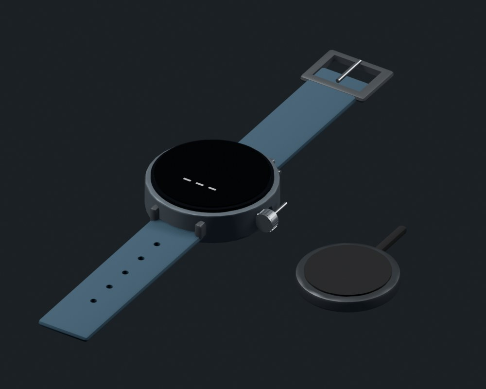
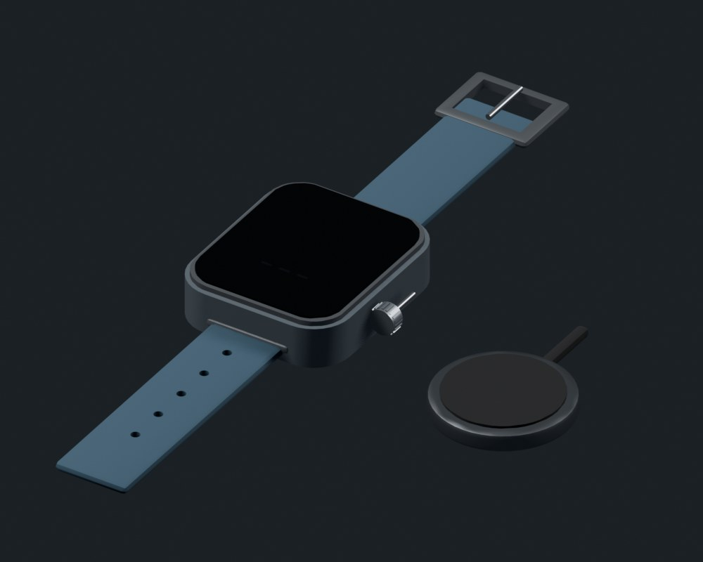

Publicar: `python3 assets/models/blender/publicar_familia.py assets/models/blender/relojes_demo.py`.
Renders: `blender -b --factory-startup --python assets/models/blender/relojes_demo.py -- --salida /tmp/relojes --renders assets/models/blender/renders/relojes_demo`.
Los montajes son genéricos de revisión, no nuevos casos ni planos comerciales. La base de carga se muestra al lado del reloj.


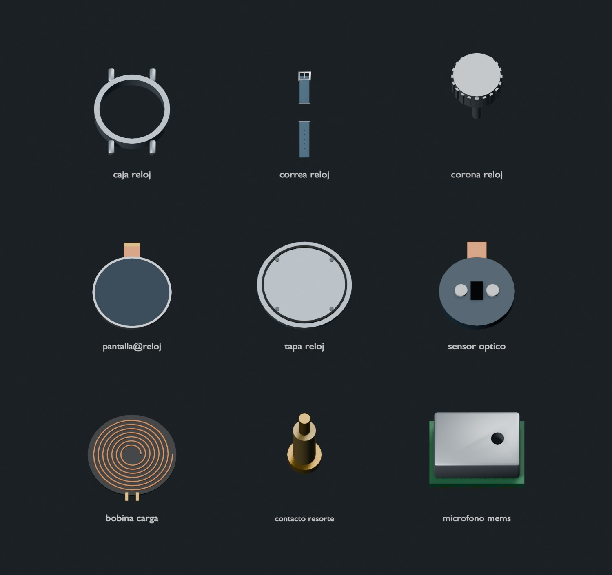

Nuevas:

- [caja_reloj](renders/cotidianos/caja_reloj.jpg) — `proporcional`.
- [correa_reloj](renders/cotidianos/correa_reloj.jpg) — `proporcional`.
- [corona_reloj](renders/cotidianos/corona_reloj.jpg) — `redondo:xz`.
- [pantalla@reloj](renders/cotidianos/pantalla@reloj.jpg) — `proporcional`.
- [tapa_reloj](renders/cotidianos/tapa_reloj.jpg) — `redondo:xz`.
- [sensor_optico](renders/cotidianos/sensor_optico.jpg) — `proporcional`.
- [bobina_carga](renders/cotidianos/bobina_carga.jpg) — `proporcional`.
- [contacto_resorte](renders/cotidianos/contacto_resorte.jpg) — `proporcional`.
- [microfono_mems](renders/cotidianos/microfono_mems.jpg) — `proporcional`.

Reutilizadas: `bateria@celular`, `placa`, `conector`, `tornillo`.

### Notebook abierta — #232 / #259

`notebook_demo.py` publica **notebook_demo.glb**, menos de 200 KiB. Incluye cuba
hueca, palmrest con huecos reales, tapa con dos bisagras, panel separado y 60 teclas
independientes (letras, números, funciones y modificadores). La pieza de la guía `tecla_p` usa la forma `tecla_individual@p`;
no es un punto dibujado sobre una caja ni parte inseparable del teclado.
`teclado@bandeja_notebook` es solo la bandeja: cada tecla se monta por su nombre.
Trackpad, batería y placa existentes se reutilizan; no se inventa RAM/SSD removible.

La tapa se llama `carcasa_pantalla@notebook` para reutilizar la receta de carcasa
sin tocar materiales.ts. El generador puede mantener `tapa_pantalla` como ID del
pack y usar esta forma en `formaBiblioteca`. GLB centrado; el plano pone el pivote
en la bisagra del borde trasero (-Z) y gira sobre X a -110°. La cara activa del panel
mira hacia -Y al cerrar; al abrir mira hacia la persona delante del teclado.
No se traslada el pivote del GLB porque rompería el contrato actual de la biblioteca.
Para la tapa publicada de 31 × 0,76 × 21,38 cm, el eje está en `[0, 0, -10.31]` cm
respecto de su centro; escalar ese desplazamiento con el tamaño de la tapa.
Las posiciones de teclas y la apertura del montaje se ven en `notebook_demo.py`;
`notebook-cobertura.json` documenta nombres y dos tamaños (32 y 36,48 cm de ancho).
La conexión a la plantilla y a la cámara sigue en #232/#259, en el otro chat.

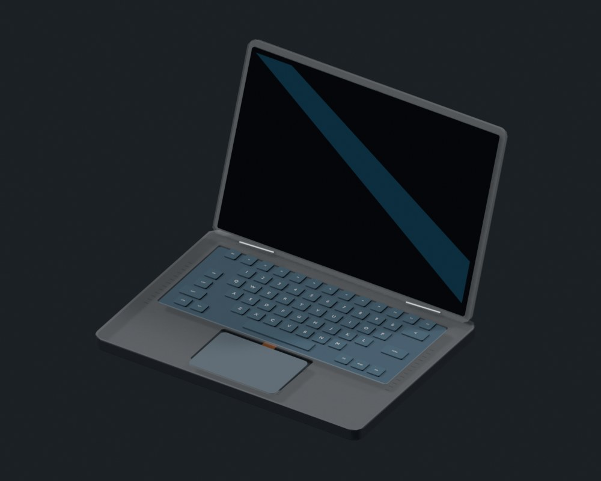
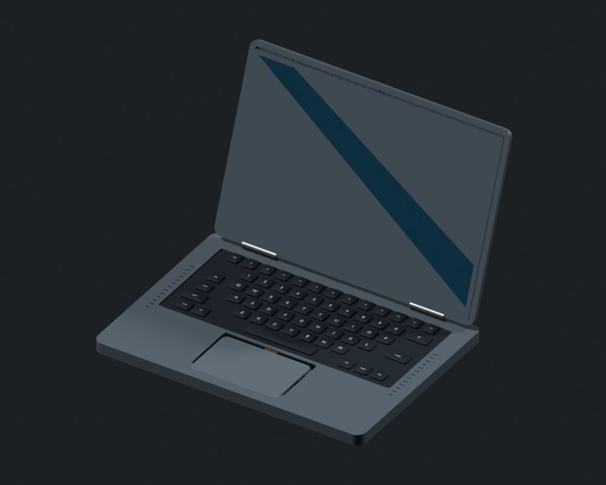

Publicar: `python3 assets/models/blender/publicar_familia.py assets/models/blender/notebook_demo.py`.
Renders: `blender -b --factory-startup --python assets/models/blender/notebook_demo.py -- --salida /tmp/notebook --renders assets/models/blender/renders/notebook_demo`.
Test: `npx vitest run assets/models/blender/notebook-demo.test.ts`.

### Reloj de pulsera

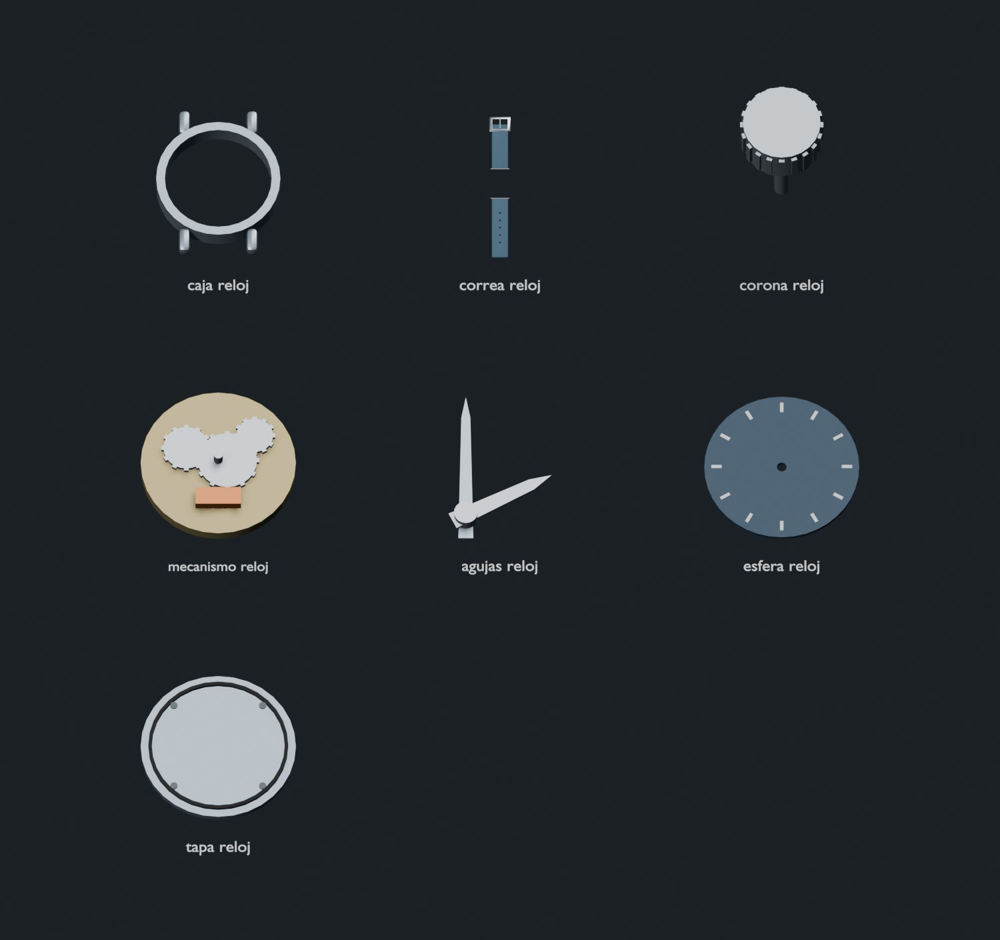

Nuevas:

- [caja_reloj](renders/cotidianos/caja_reloj.jpg) — `proporcional`.
- [correa_reloj](renders/cotidianos/correa_reloj.jpg) — `proporcional`.
- [corona_reloj](renders/cotidianos/corona_reloj.jpg) — `redondo:xz`.
- [mecanismo_reloj](renders/cotidianos/mecanismo_reloj.jpg) — `redondo:xz`.
- [agujas_reloj](renders/cotidianos/agujas_reloj.jpg) — `proporcional`.
- [esfera_reloj](renders/cotidianos/esfera_reloj.jpg) — `redondo:xz`.
- [tapa_reloj](renders/cotidianos/tapa_reloj.jpg) — `redondo:xz`.

Reutilizadas: `pila`, `tornillo`.

### Auriculares inalámbricos

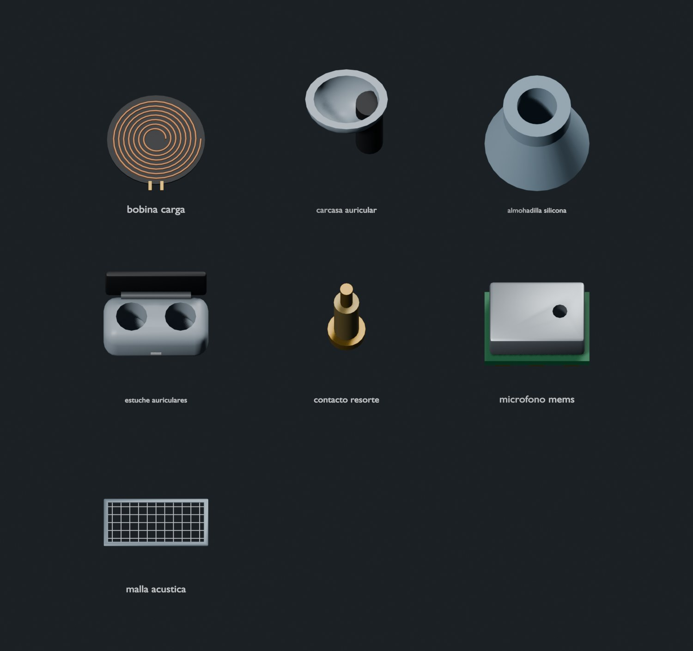

Nuevas:

- [bobina_carga](renders/cotidianos/bobina_carga.jpg) — `proporcional`.
- [carcasa_auricular](renders/cotidianos/carcasa_auricular.jpg) — `proporcional`.
- [almohadilla_silicona](renders/cotidianos/almohadilla_silicona.jpg) — `redondo:xz`.
- [estuche_auriculares](renders/cotidianos/estuche_auriculares.jpg) — `proporcional`.
- [contacto_resorte](renders/cotidianos/contacto_resorte.jpg) — `proporcional`.
- [microfono_mems](renders/cotidianos/microfono_mems.jpg) — `proporcional`.
- [malla_acustica](renders/cotidianos/malla_acustica.jpg) — `libre`.

Reutilizadas: `bateria@celular`, `parlante@celular`, `placa`, `conector@usb_c`.

### Parlante Bluetooth

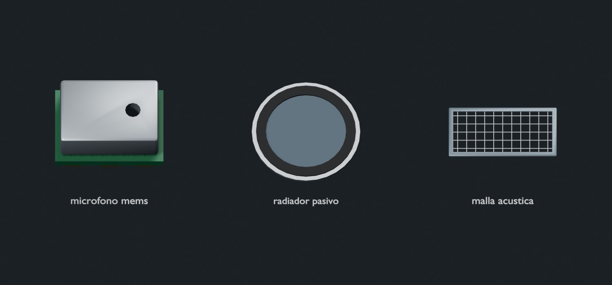

Nuevas:

- [microfono_mems](renders/cotidianos/microfono_mems.jpg) — `proporcional`.
- [radiador_pasivo](renders/cotidianos/radiador_pasivo.jpg) — `redondo:xz`.
- [malla_acustica](renders/cotidianos/malla_acustica.jpg) — `libre`.

Reutilizadas: `parlante`, `bateria@celular`, `placa`, `conector@usb_c`, `boton_reset`.

### Control remoto

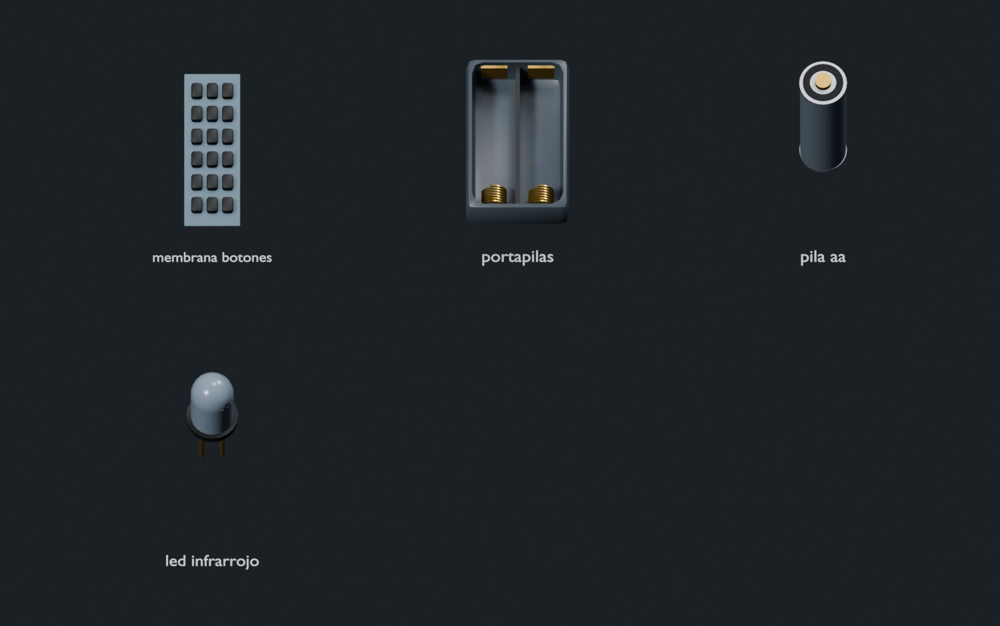

Nuevas:

- [membrana_botones](renders/cotidianos/membrana_botones.jpg) — `libre`.
- [portapilas](renders/cotidianos/portapilas.jpg) — `proporcional`.
- [pila_aa](renders/cotidianos/pila_aa.jpg) — `redondo:xz`.
- [led_infrarrojo](renders/cotidianos/led_infrarrojo.jpg) — `proporcional`.

Reutilizadas: `placa`, `tornillo`.

### Cargador de celular

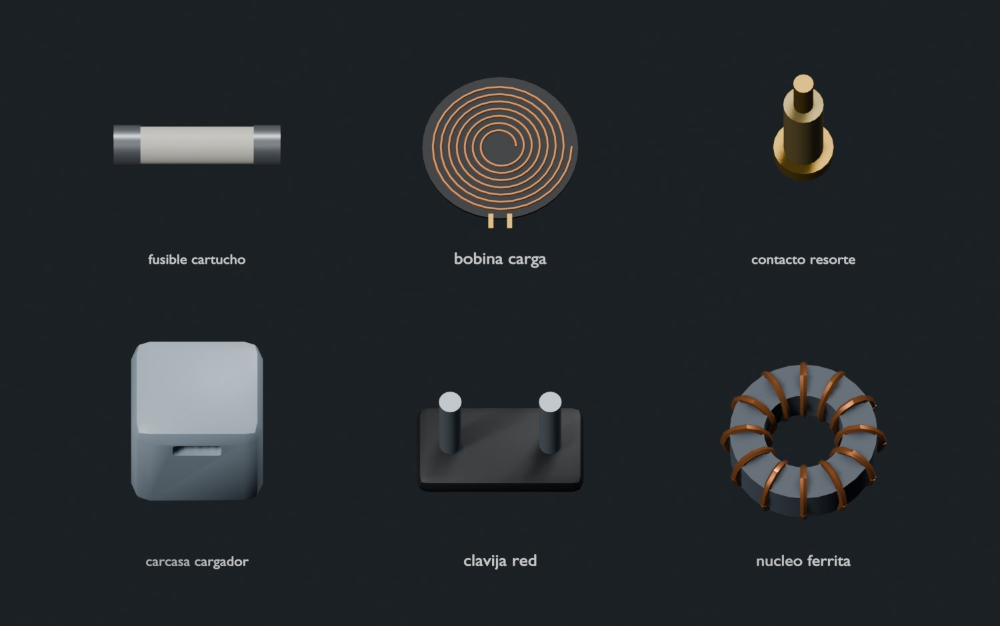

Nuevas:

- [fusible_cartucho](renders/cotidianos/fusible_cartucho.jpg) — `tramo:x:redondo`.
- [bobina_carga](renders/cotidianos/bobina_carga.jpg) — `proporcional`.
- [contacto_resorte](renders/cotidianos/contacto_resorte.jpg) — `proporcional`.
- [carcasa_cargador](renders/cotidianos/carcasa_cargador.jpg) — `proporcional`.
- [clavija_red](renders/cotidianos/clavija_red.jpg) — `proporcional`.
- [nucleo_ferrita](renders/cotidianos/nucleo_ferrita.jpg) — `redondo:xz`.

Reutilizadas: `fuente`, `transformador`, `capacitor`, `conector@usb_c`, `conector_usb_a`, `cable@redondo`.


## Piezas grandes con borde claro — #231

`contornos_demo.py` publica **contornos_demo.glb** (menos de 10 KB), con
`carcasa_contorno@tablet`, `panel_contorno@tablet`, `carcasa_contorno@tv` y
`panel_contorno@tv`. Son mallas con abertura central, pared y labio continuo;
no hay un rectángulo sólido invisible detrás que vuelva a tapar las piezas.
Los renders muestran una placa a través del centro, en dos tamaños por tipo.

Son **formas auxiliares para el resaltado**. No se deben elegir como reemplazo de
la pantalla o carcasa completa en estado cerrado: el equipo perdería su cara.
El chat del visor controla cuándo usar el borde y cuánto transparentar la superficie
original (#261). Este PR no resuelve el texto del paso ni cambia shaders del visor.
Las reglas son por tipo/orientación y dimensiones; no hay marcas ni modelos.

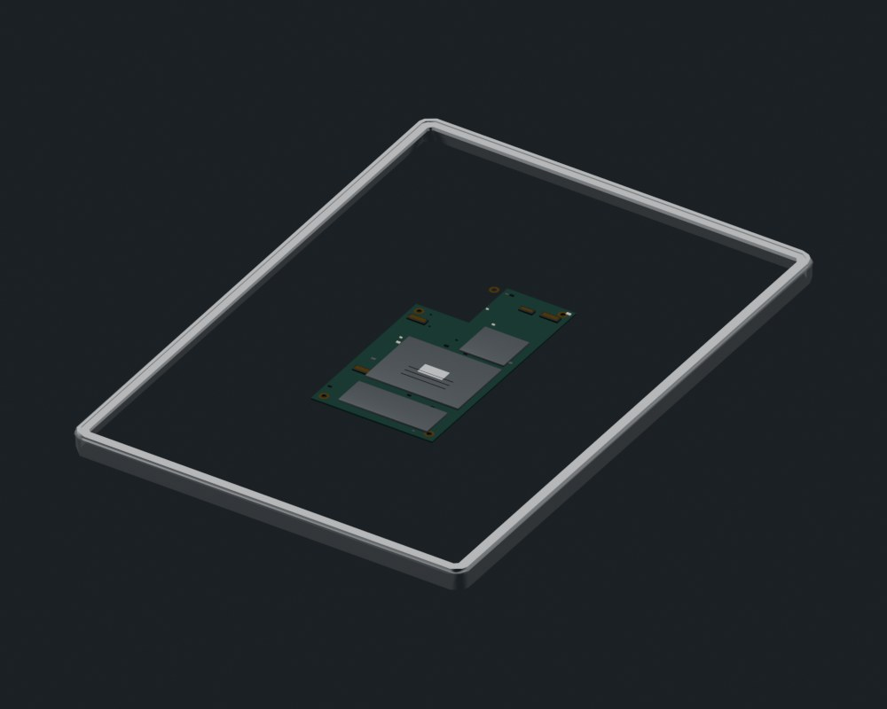
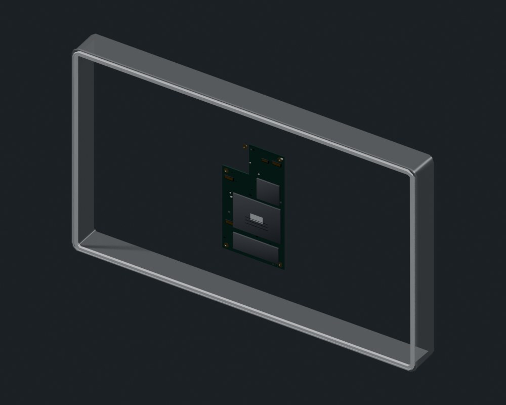

Cobertura: `contornos-cobertura.json`. Los tests tiran rayos por varios puntos del
centro (deben atravesar) y por el borde (deben chocar), a escalas 0,85 y 1,2.
Publicar: `python3 assets/models/blender/publicar_familia.py assets/models/blender/contornos_demo.py`.
Renders: `blender -b --factory-startup --python assets/models/blender/contornos_demo.py -- --salida /tmp/contornos --renders assets/models/blender/renders/contornos_demo`.
Test: `npx vitest run assets/models/blender/contornos-demo.test.ts`.

## Tablet completa — #233

`tablet_demo.py` publica **tablet_demo.glb** (12 KB): `marco@tablet` hueco,
`tapa_trasera@tablet`, `pantalla@tablet` y `bateria@tablet`. Placa, cámara y tornillos
se reutilizan por nombre. Son piezas distintas, sin fusionar todo en una sola malla;
el plano puede desplazar el frente, levantar la trasera y quitar tornillos por separado.
La cara activa mira a +Y en el GLB (+Z de Blender), sin girar la tablet sobre su espalda.
El modelo cerrado tiene el frente completo y opaco; el render abierto usa esas mismas piezas.

Cobertura: `tablet-cobertura.json`, dos tamaños de 17,5 × 25 y 21,35 × 30,5 cm.
La cámara inicial, el cierre y los pasos de apertura del producto los conecta el otro
chat por #233; agregar mallas no cambia por sí solo la coreografía existente.

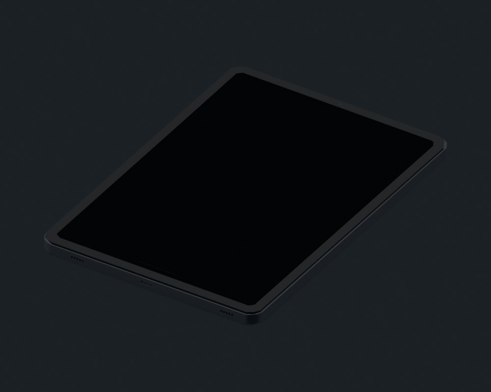
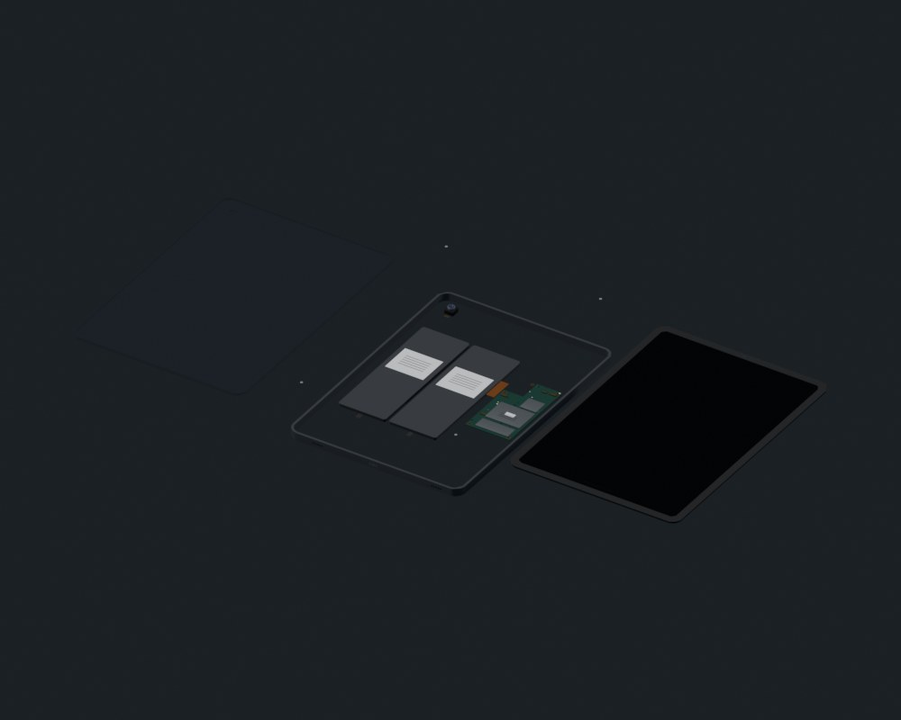

Publicar: `python3 assets/models/blender/publicar_familia.py assets/models/blender/tablet_demo.py`.
Renders: `blender -b --factory-startup --python assets/models/blender/tablet_demo.py -- --salida /tmp/tablet --renders assets/models/blender/renders/tablet_demo`.
Test: `npx vitest run assets/models/blender/tablet-demo.test.ts`.

## Alineación celular y TV (#188)

`alineacion_demo.glb` conserva las familias anteriores y publica los nombres canónicos
`carcasa_televisor`, `pantalla_panel`, `placa_carga` y la placa AV `placa@televisor`.
Las cámaras reutilizan `camara@modulo` y `camara`: no se renombran porque ya existe
un contrato del visor y pruebas que protegen esos nombres. El mapa exacto de IDs
a nodos está en `alineacion-cobertura.json`. Materiales resueltos con las recetas
existentes; AJUSTES explícitos. Dos celulares (escala 1 y 1,12) y TV 46/32 pulgadas.

La placa principal de TV necesita `formaBiblioteca: "placa@televisor"` en el plano;
no se cambia el selector compartido. T-con, soporte y tornillos existen en biblioteca,
pero falta asegurar su inclusión en los planos. Seguimiento de integración en #188.
Los renders son inspecciones de assets comprimidos; no sustituyen capturas del visor.
