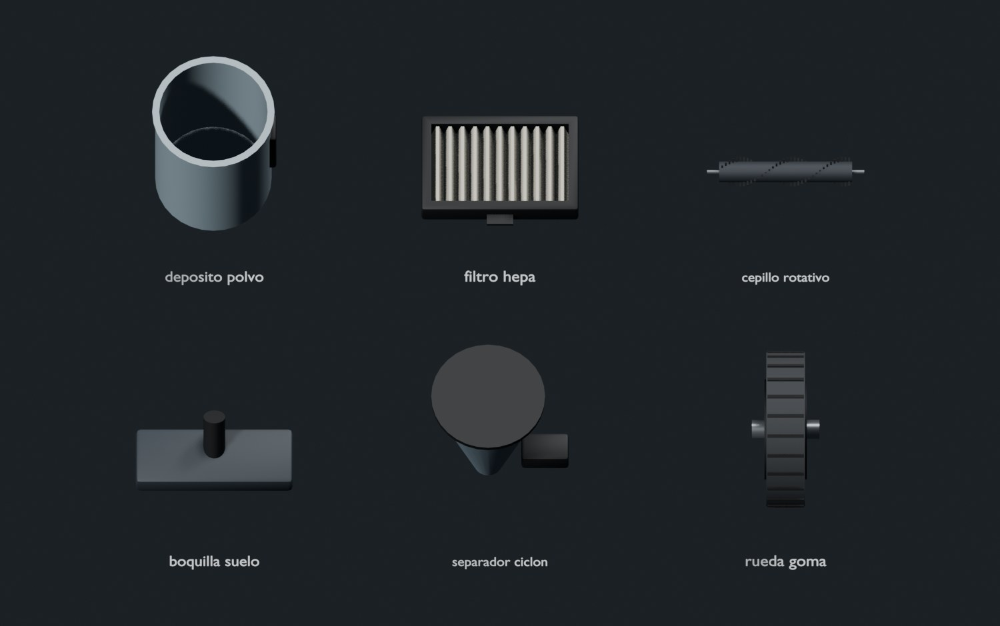
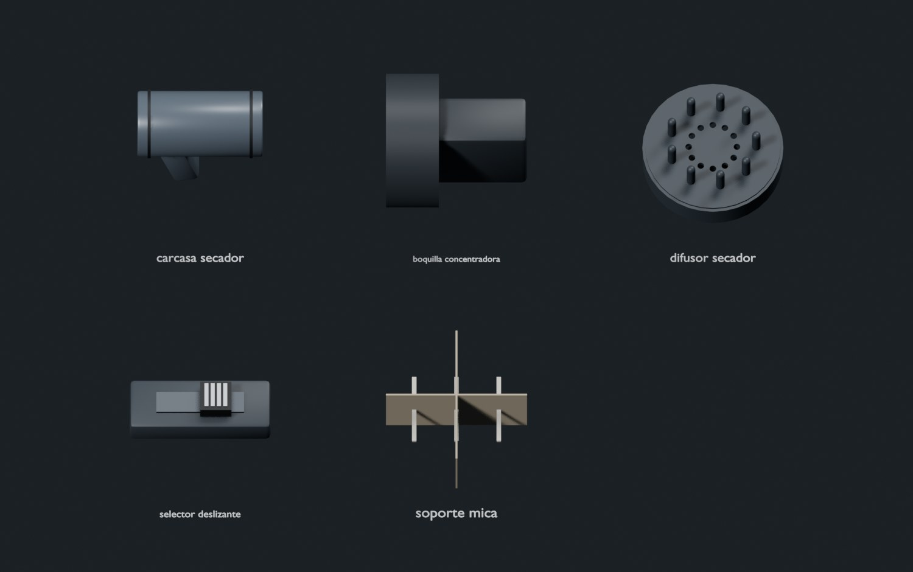
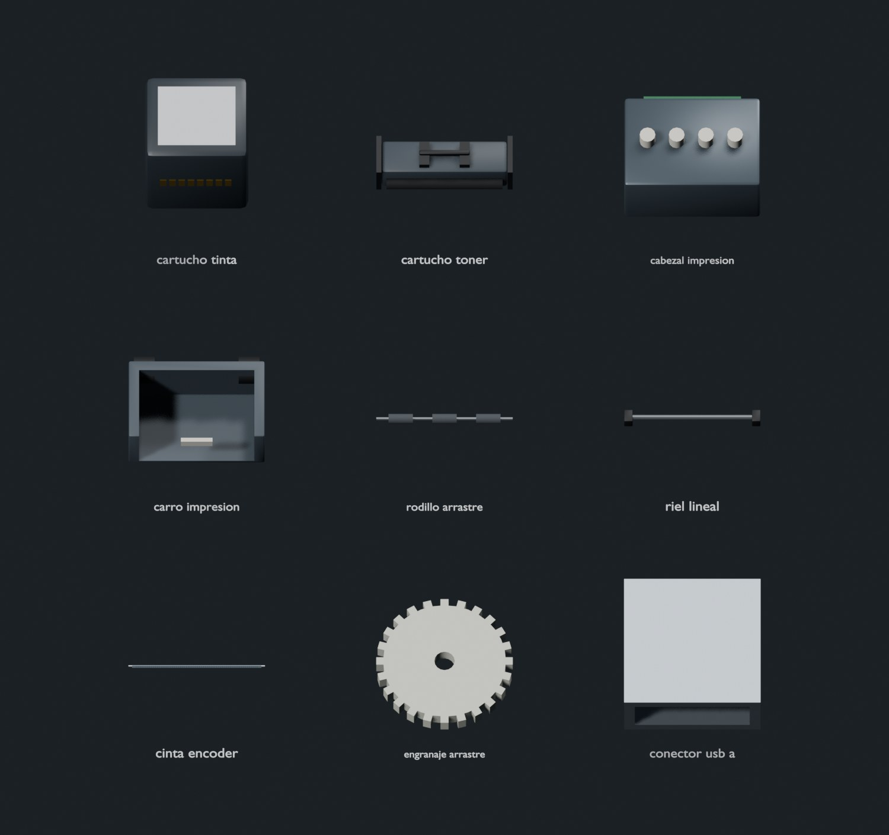
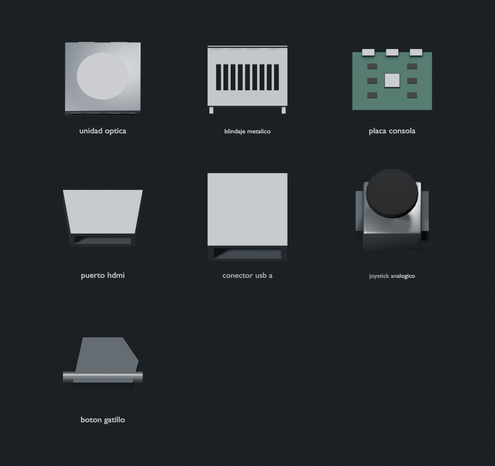
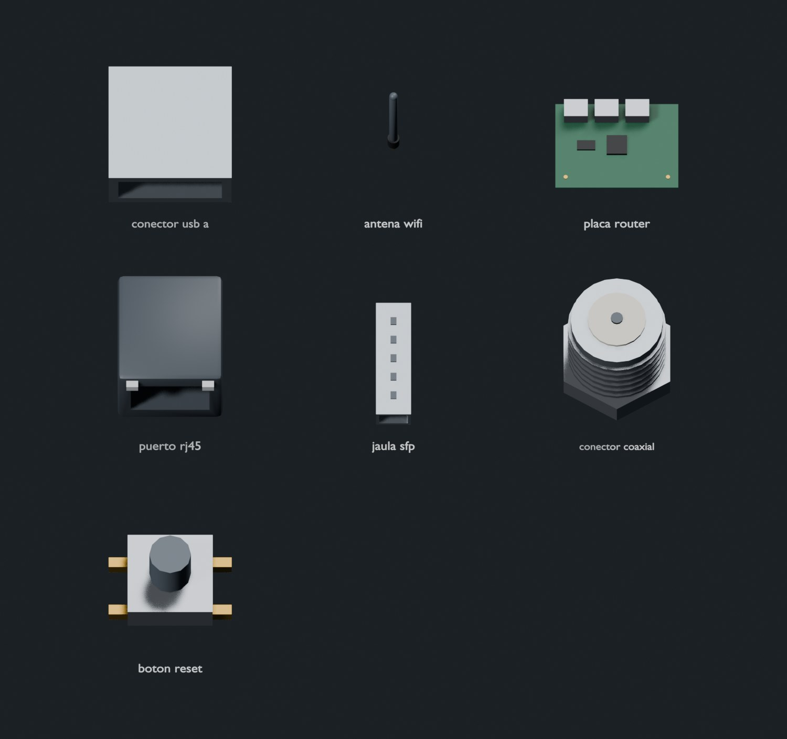
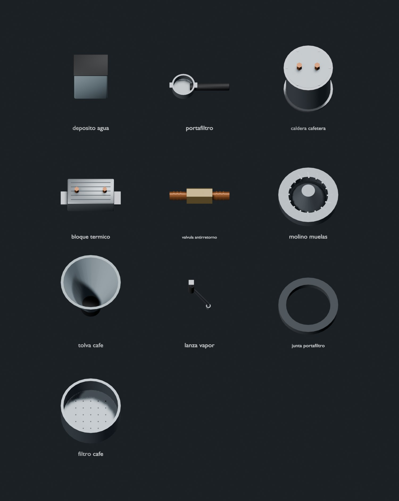

# Familia independiente: dispositivos

42 componentes genéricos para aspiradora, secador de pelo, impresora, consola, router/módem y cafetera.

- Generador: `dispositivos.py`, reutiliza las primitivas de `piezas.py` mediante importación sin ejecutar su `main`.
- Archivo: `public/models/piezas/dispositivos.glb` (menos de 1 MB).
- El índice agrega la familia `dispositivos`; el visor la descarga a demanda cuando un ID la necesita.
- Las recetas de material están aisladas en `lib/planogenerator/materiales-dispositivos.ts`.
- Cada componente tiene nodo raíz nombrado, cuerpo y detalles. Las medidas están en centímetros.
- No se modelan evaporador, turbina, retroiluminación, bandejas, compresor, panel de TV, tambor ni bomba.

## Regeneración

```sh
npm run modelos:dispositivos
npm run modelos:dispositivos -- --renders assets/models/blender/renders/dispositivos
```

Requiere Blender 4.2+ en PATH. No requiere APIs ni claves. El generador solo escribe su GLB y sus
entradas del índice. El generador principal conserva las familias independientes al regenerar las suyas.
La actualización del índice rechaza IDs pertenecientes a otras familias.

Para rehacer solo algunas vistas individuales (las seis hojas siempre se regeneran):

```sh
npm run modelos:dispositivos -- --renders assets/models/blender/renders/dispositivos --render-piezas portafiltro,puerto_rj45
```

## Verificación

```sh
python3 assets/models/blender/test_indice.py
npm test
npm run typecheck
npm run lint
npm run build
```

Las pruebas comprueban tamaño del GLB, correspondencia con el índice, carga por prefijo, cobertura
de los seis equipos, materiales, posiciones/normales finitas y construcción de nodos animables.
Las pruebas del índice no necesitan instalar Blender.

Son formas de referencia por tipo: no certifican compatibilidad de repuestos, dimensiones del modelo,
esquemas eléctricos ni un procedimiento de reparación. La ubicación real sigue siendo responsabilidad
del plano interpretado del manual y de las validaciones del producto.

## Vistas por equipo

### Aspiradora



- [deposito_polvo](renders/dispositivos/deposito_polvo.jpg)
- [filtro_hepa](renders/dispositivos/filtro_hepa.jpg)
- [cepillo_rotativo](renders/dispositivos/cepillo_rotativo.jpg)
- [boquilla_suelo](renders/dispositivos/boquilla_suelo.jpg)
- [separador_ciclon](renders/dispositivos/separador_ciclon.jpg)
- [rueda_goma](renders/dispositivos/rueda_goma.jpg)

### Secador de pelo



- [carcasa_secador](renders/dispositivos/carcasa_secador.jpg)
- [boquilla_concentradora](renders/dispositivos/boquilla_concentradora.jpg)
- [difusor_secador](renders/dispositivos/difusor_secador.jpg)
- [selector_deslizante](renders/dispositivos/selector_deslizante.jpg)
- [soporte_mica](renders/dispositivos/soporte_mica.jpg)

### Impresora



- [cartucho_tinta](renders/dispositivos/cartucho_tinta.jpg)
- [cartucho_toner](renders/dispositivos/cartucho_toner.jpg)
- [cabezal_impresion](renders/dispositivos/cabezal_impresion.jpg)
- [carro_impresion](renders/dispositivos/carro_impresion.jpg)
- [rodillo_arrastre](renders/dispositivos/rodillo_arrastre.jpg)
- [riel_lineal](renders/dispositivos/riel_lineal.jpg)
- [cinta_encoder](renders/dispositivos/cinta_encoder.jpg)
- [engranaje_arrastre](renders/dispositivos/engranaje_arrastre.jpg)

### Consola de videojuegos



- [unidad_optica](renders/dispositivos/unidad_optica.jpg)
- [blindaje_metalico](renders/dispositivos/blindaje_metalico.jpg)
- [placa_consola](renders/dispositivos/placa_consola.jpg)
- [puerto_hdmi](renders/dispositivos/puerto_hdmi.jpg)
- [conector_usb_a](renders/dispositivos/conector_usb_a.jpg)
- [joystick_analogico](renders/dispositivos/joystick_analogico.jpg)
- [boton_gatillo](renders/dispositivos/boton_gatillo.jpg)

### Router y módem



- [antena_wifi](renders/dispositivos/antena_wifi.jpg)
- [placa_router](renders/dispositivos/placa_router.jpg)
- [puerto_rj45](renders/dispositivos/puerto_rj45.jpg)
- [jaula_sfp](renders/dispositivos/jaula_sfp.jpg)
- [conector_coaxial](renders/dispositivos/conector_coaxial.jpg)
- [boton_reset](renders/dispositivos/boton_reset.jpg)

### Cafetera



- [deposito_agua](renders/dispositivos/deposito_agua.jpg)
- [portafiltro](renders/dispositivos/portafiltro.jpg)
- [caldera_cafetera](renders/dispositivos/caldera_cafetera.jpg)
- [bloque_termico](renders/dispositivos/bloque_termico.jpg)
- [valvula_antirretorno](renders/dispositivos/valvula_antirretorno.jpg)
- [molino_muelas](renders/dispositivos/molino_muelas.jpg)
- [tolva_cafe](renders/dispositivos/tolva_cafe.jpg)
- [lanza_vapor](renders/dispositivos/lanza_vapor.jpg)
- [junta_portafiltro](renders/dispositivos/junta_portafiltro.jpg)
- [filtro_cafe](renders/dispositivos/filtro_cafe.jpg)

