# Familia independiente: equipos de facultad

42 formas faltantes en `public/models/piezas/facultad.glb` (menos de 2 MB),
reutilizando por nombre 49 tipos de las familias previas. El mapa de 15 grupos separa Air,
Pro, iMac, monitor, iPhone, Samsung, TV, proyector e impresora y los seis periféricos.
`facultad-cobertura.json` es el inventario comprobable de formas nuevas y reutilizadas;
no es un catálogo de equipos comerciales ni un plano cargado en el producto.

## Uso y regeneración

```sh
npm run modelos:facultad
npm run modelos:facultad -- --renders assets/models/blender/renders/facultad
npm run modelos:facultad -- --renders assets/models/blender/renders/facultad --render-piezas trackpad,placa_logica_integrada
```

Requiere Blender 4.2+ en PATH, sin APIs ni claves. Reutiliza las primitivas y cierre de materiales
de los scripts existentes sin ejecutar sus generadores. Solo escribe su GLB y sus entradas del
índice; el actualizador preserva las familias ajenas y rechaza IDs ocupados.

Cada una de las 42 formas tiene nodo raíz nombrado y regla explícita en `AJUSTES` de `piezas.py`,
exportada al índice y a `extras.ajuste`. Las recetas de material se agregan al final de `RECETAS`,
después de todas las existentes. Ejes del GLB: X, Z y -Y de Blender; unidades: centímetros.
Placas y teclados admiten ajuste libre; aros y lentes conservan sección; el fotoconductor ajusta
el tramo; conectores, carcasas y conjuntos asimétricos escalan proporcionalmente.

## Qué se reutiliza y qué faltaba

- MacBook: batería de pouch adheridos y placa integrada, trackpad y teclado fino nuevos.
  Pantalla, parlantes, cámara y flex de pantalla (`cable`) se reutilizan; el blower existente
  solo figura en la cobertura Pro. La placa nueva no tiene zócalos SO-DIMM ni SSD M.2.
- iMac/monitor: panel (`pantalla@panel`), retroiluminación, fuente y cables existentes;
  se agregan soporte, T-con suelta y placa lógica/AV según el tipo de equipo.
- Celulares: batería, pantalla, cámaras, placa, USB-C, parlante y bobina ya existentes;
  se agregan sensores, actuadores hápticos, bandeja SIM independiente y variante Lightning.
- TV: panel, tiras, retroiluminación, fuente, parlantes y carcasa reutilizados;
  T-con y placa AV nuevas para poder nombrarlas y animarlas independientemente.
- Impresora: los ocho tipos de impresión/arrastre existentes; se completa láser con fusor,
  cilindro fotoconductor (distinto de `tambor` de lavarropas) y sensor de papel.
- Joystick/parlante PC: sticks, gatillos, parlantes y malla existentes; se agregan controles,
  carcasa, actuadores y potenciómetro donde faltaban formas independientes.

Las variantes nuevas de `bateria`, `teclado`, `motor_vibracion` y `conector` comparten los tipos
base y la selección habitual por forma/equipo del visor. No se sustituyen las variantes previas.

## Límites de estas formas

Los módulos son ilustraciones genéricas, no repuestos compatibles ni modelos de fabricación.
Las marcas indican el contexto solicitado, no que la geometría reproduzca un modelo exacto.
La selección, cantidad, presencia y ubicación de componentes siguen requiriendo el manual/plano.
Este inventario no modifica el generador de planos, la plantilla genérica de notebook ni las
validaciones de seguridad existentes. Las arquitecturas alternativas no son una lista de piezas
obligatorias: cada grupo explica qué debe confirmarse.

Incluye 42 renders individuales y 15 hojas. En cada hoja las piezas se normalizan por separado:
no muestran escala relativa, un montaje ni un despiece real. Las hojas muestran solo las nuevas;
los tipos reutilizados aparecen listados debajo.

## Verificación

```sh
python3 assets/models/blender/test_indice.py
npm test
npm run typecheck
npm run build
```

Las pruebas verifican cobertura, reutilización de IDs previos, exclusión de RAM/SSD removibles y
ventilador del Air en el inventario, carga a demanda, coherencia fuente/índice/GLB de AJUSTES,
render de cada pieza, materiales y geometría finita antes/después de ajustar y nodos animables.
La suite general mantiene las comprobaciones de todas las familias previas y de formas redondas.

## Galería por equipo

### MacBook Air (Apple Silicon)

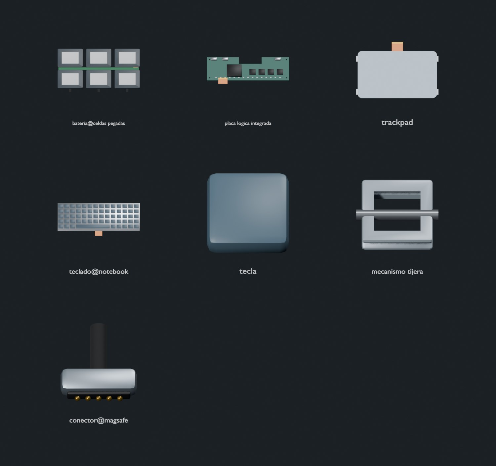

Nuevas:

- [bateria@celdas_pegadas](renders/facultad/bateria@celdas_pegadas.jpg) — `proporcional`.
- [placa_logica_integrada](renders/facultad/placa_logica_integrada.jpg) — `libre`.
- [trackpad](renders/facultad/trackpad.jpg) — `libre`.
- [teclado@notebook](renders/facultad/teclado@notebook.jpg) — `libre`.
- [tecla](renders/facultad/tecla.jpg) — `proporcional`.
- [mecanismo_tijera](renders/facultad/mecanismo_tijera.jpg) — `proporcional`.
- [conector@magsafe](renders/facultad/conector@magsafe.jpg) — `proporcional`.

Reutilizadas: `base`, `tapa_inferior`, `pantalla`, `camara`, `parlante`, `cable`, `disipador`, `conector@usb_c`, `tornillo`.

Solo formas genéricas. Sin ventilador, RAM SO-DIMM, SSD M.2 ni Wi-Fi removible en esta cobertura de Apple Silicon. No es un plano exacto ni una plantilla de reparación.

### MacBook Pro (Apple Silicon)


Nuevas:

- [bateria@celdas_pegadas](renders/facultad/bateria@celdas_pegadas.jpg) — `proporcional`.
- [placa_logica_integrada](renders/facultad/placa_logica_integrada.jpg) — `libre`.
- [trackpad](renders/facultad/trackpad.jpg) — `libre`.
- [teclado@notebook](renders/facultad/teclado@notebook.jpg) — `libre`.
- [tecla](renders/facultad/tecla.jpg) — `proporcional`.
- [mecanismo_tijera](renders/facultad/mecanismo_tijera.jpg) — `proporcional`.
- [conector@magsafe](renders/facultad/conector@magsafe.jpg) — `proporcional`.

Reutilizadas: `base`, `tapa_inferior`, `pantalla`, `camara`, `parlante`, `cable`, `disipador`, `heatpipe`, `ventilador`, `conector@usb_c`, `tornillo`.

Ventilador reutilizado como blower genérico, cantidad según plano confirmado. Sin RAM SO-DIMM, SSD M.2 ni Wi-Fi removible en esta cobertura de Apple Silicon.

### iMac

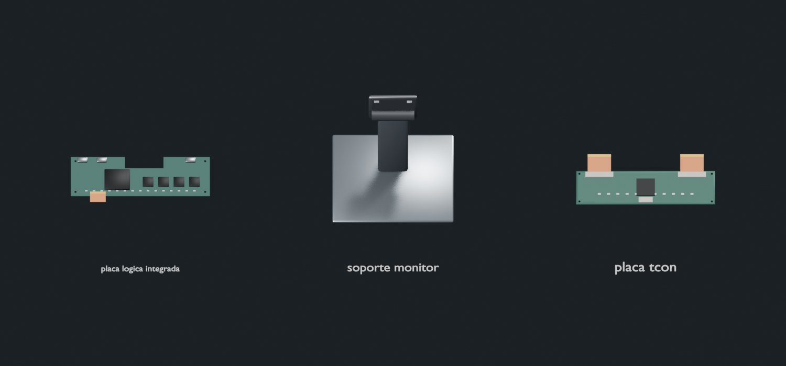

Nuevas:

- [placa_logica_integrada](renders/facultad/placa_logica_integrada.jpg) — `libre`.
- [soporte_monitor](renders/facultad/soporte_monitor.jpg) — `proporcional`.
- [placa_tcon](renders/facultad/placa_tcon.jpg) — `libre`.

Reutilizadas: `pantalla@panel`, `retroiluminacion`, `fuente`, `parlante`, `camara`, `cable`, `tornillo`.

Panel y retroiluminación son referencias visuales por tipo. Fuente interna, T-con y número de módulos dependen del equipo, no se dan por confirmados.

### Monitor

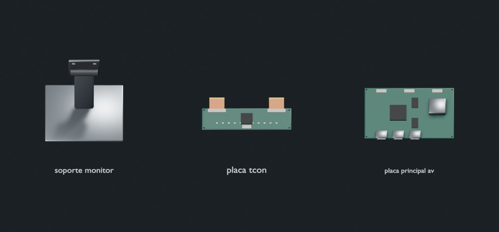

Nuevas:

- [soporte_monitor](renders/facultad/soporte_monitor.jpg) — `proporcional`.
- [placa_tcon](renders/facultad/placa_tcon.jpg) — `libre`.
- [placa_principal_av](renders/facultad/placa_principal_av.jpg) — `libre`.

Reutilizadas: `pantalla@panel`, `retroiluminacion`, `fuente`, `tira_led`, `cable`, `puerto_hdmi`, `tornillo`.

T-con puede estar integrada en el panel. El soporte genérico no certifica montaje ni norma VESA.

### iPhone

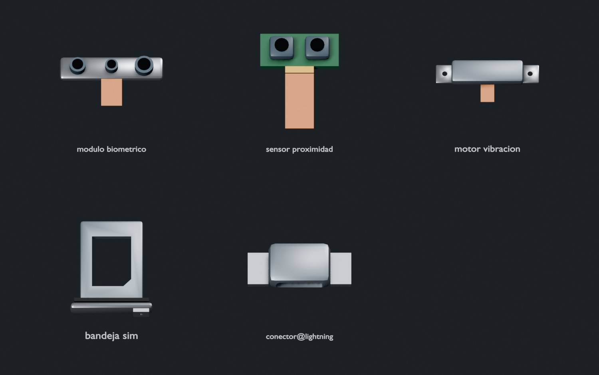

Nuevas:

- [modulo_biometrico](renders/facultad/modulo_biometrico.jpg) — `proporcional`.
- [sensor_proximidad](renders/facultad/sensor_proximidad.jpg) — `proporcional`.
- [motor_vibracion](renders/facultad/motor_vibracion.jpg) — `proporcional`.
- [bandeja_sim](renders/facultad/bandeja_sim.jpg) — `proporcional`.
- [conector@lightning](renders/facultad/conector@lightning.jpg) — `proporcional`.

Reutilizadas: `bateria@celular`, `pantalla`, `camara`, `camara@modulo`, `placa_madre@celular`, `conector@usb_c`, `parlante@celular`, `microfono_mems`, `bobina_carga`, `marco`, `tapa_trasera`, `tornillo`.

USB-C o Lightning según el equipo. Bandeja SIM solo si existe; no todos los equipos la incluyen. Módulo biométrico ilustrativo, sin compatibilidad de Face ID.

### Samsung Galaxy

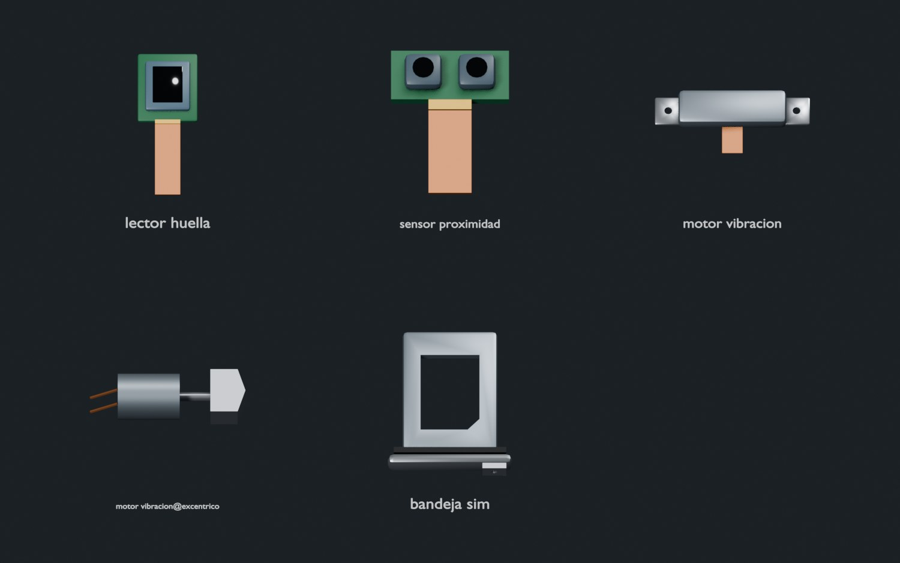

Nuevas:

- [lector_huella](renders/facultad/lector_huella.jpg) — `proporcional`.
- [sensor_proximidad](renders/facultad/sensor_proximidad.jpg) — `proporcional`.
- [motor_vibracion](renders/facultad/motor_vibracion.jpg) — `proporcional`.
- [motor_vibracion@excentrico](renders/facultad/motor_vibracion@excentrico.jpg) — `proporcional`.
- [bandeja_sim](renders/facultad/bandeja_sim.jpg) — `proporcional`.

Reutilizadas: `bateria@celular`, `pantalla`, `camara`, `camara@modulo`, `placa_madre@celular`, `conector@usb_c`, `parlante@celular`, `microfono_mems`, `bobina_carga`, `marco`, `tapa_trasera`, `tornillo`.

Huella, actuador lineal o excéntrico son alternativas por confirmar. No presupone reconocimiento facial de profundidad ni bandeja SIM en todos los modelos.

### Televisor LED multimarca

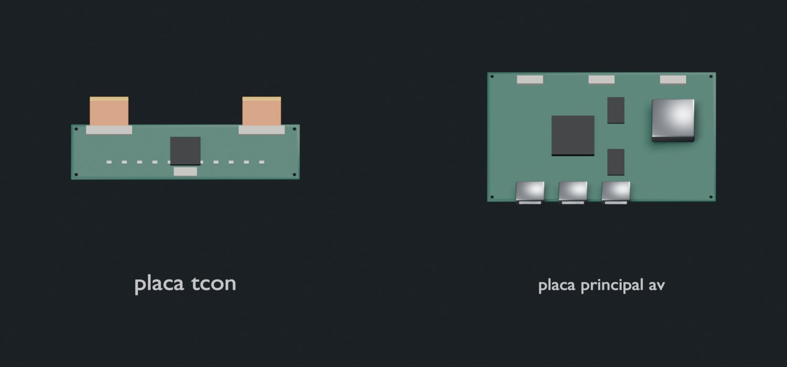

Nuevas:

- [placa_tcon](renders/facultad/placa_tcon.jpg) — `libre`.
- [placa_principal_av](renders/facultad/placa_principal_av.jpg) — `libre`.

Reutilizadas: `pantalla@panel`, `retroiluminacion`, `tira_led`, `fuente`, `parlante`, `cable`, `carcasa@televisor`, `puerto_hdmi`, `tornillo`.

Placa AV, T-con y tiras LED son formas genéricas multimarca. Su presencia, cantidad y distribución salen del plano/manual.

### Proyector

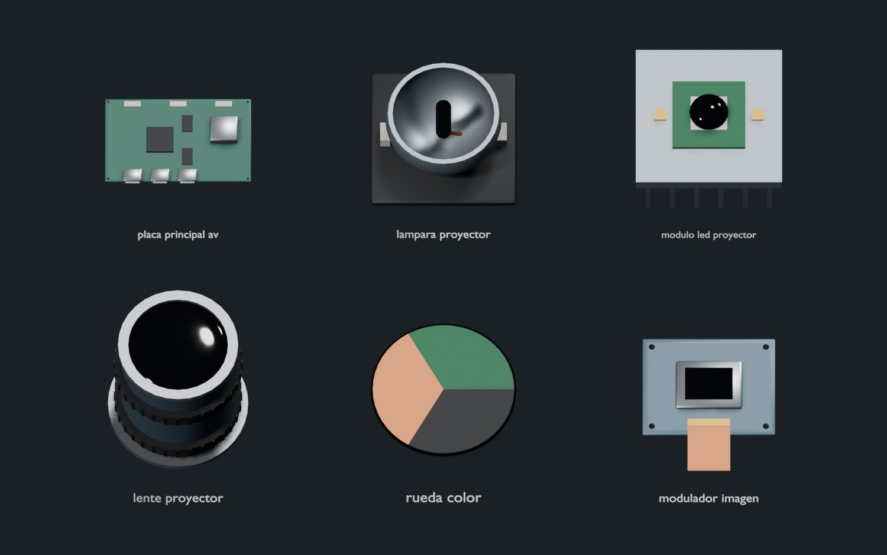

Nuevas:

- [placa_principal_av](renders/facultad/placa_principal_av.jpg) — `libre`.
- [lampara_proyector](renders/facultad/lampara_proyector.jpg) — `proporcional`.
- [modulo_led_proyector](renders/facultad/modulo_led_proyector.jpg) — `proporcional`.
- [lente_proyector](renders/facultad/lente_proyector.jpg) — `redondo:xz`.
- [rueda_color](renders/facultad/rueda_color.jpg) — `redondo:xz`.
- [modulador_imagen](renders/facultad/modulador_imagen.jpg) — `proporcional`.

Reutilizadas: `ventilador`, `ventilador@axial`, `fuente`, `placa`, `cable`, `puerto_hdmi`, `tornillo`.

Lámpara o LED como alternativas; rueda de color solo si corresponde. No se supone que todos los proyectores compartan la misma tecnología.

### Impresora

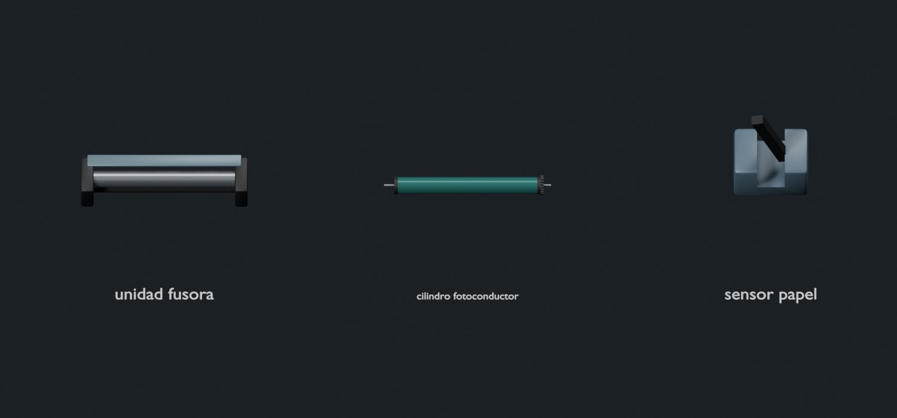

Nuevas:

- [unidad_fusora](renders/facultad/unidad_fusora.jpg) — `proporcional`.
- [cilindro_fotoconductor](renders/facultad/cilindro_fotoconductor.jpg) — `tramo:x:redondo`.
- [sensor_papel](renders/facultad/sensor_papel.jpg) — `proporcional`.

Reutilizadas: `cartucho_tinta`, `cartucho_toner`, `cabezal_impresion`, `carro_impresion`, `rodillo_arrastre`, `riel_lineal`, `cinta_encoder`, `engranaje_arrastre`, `fuente`, `motor`, `placa@control`, `conector_usb_a`, `tornillo`.

Cartucho/cabezal para inyección; tóner/fusor/fotoconductor para láser. No se mezclan automáticamente ambas arquitecturas.

### Mouse

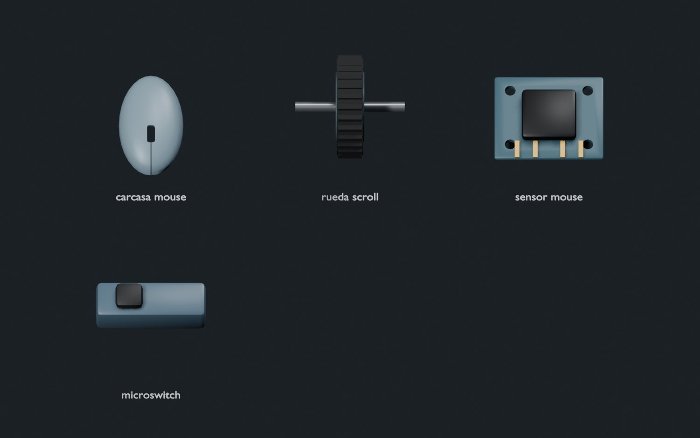

Nuevas:

- [carcasa_mouse](renders/facultad/carcasa_mouse.jpg) — `proporcional`.
- [rueda_scroll](renders/facultad/rueda_scroll.jpg) — `redondo:yz`.
- [sensor_mouse](renders/facultad/sensor_mouse.jpg) — `proporcional`.
- [microswitch](renders/facultad/microswitch.jpg) — `proporcional`.

Reutilizadas: `placa`, `conector_usb_a`, `cable@redondo`, `pila_aa`, `bateria@celular`, `tornillo`.

Pila, batería y cable son alternativas según el equipo, no un conjunto obligatorio.

### Teclado externo

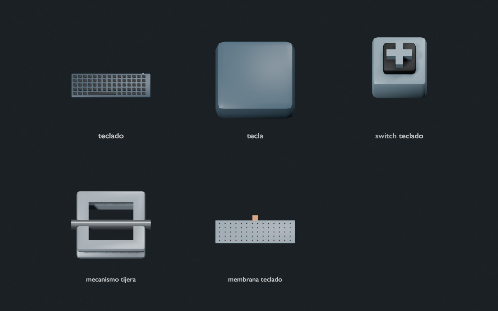

Nuevas:

- [teclado](renders/facultad/teclado.jpg) — `libre`.
- [tecla](renders/facultad/tecla.jpg) — `proporcional`.
- [switch_teclado](renders/facultad/switch_teclado.jpg) — `proporcional`.
- [mecanismo_tijera](renders/facultad/mecanismo_tijera.jpg) — `proporcional`.
- [membrana_teclado](renders/facultad/membrana_teclado.jpg) — `libre`.

Reutilizadas: `placa`, `conector_usb_a`, `cable@redondo`, `pila_aa`, `bateria@celular`, `tornillo`.

Mecánico, membrana y tijera son alternativas; la geometría no impone distribución regional.

### Joystick / mando

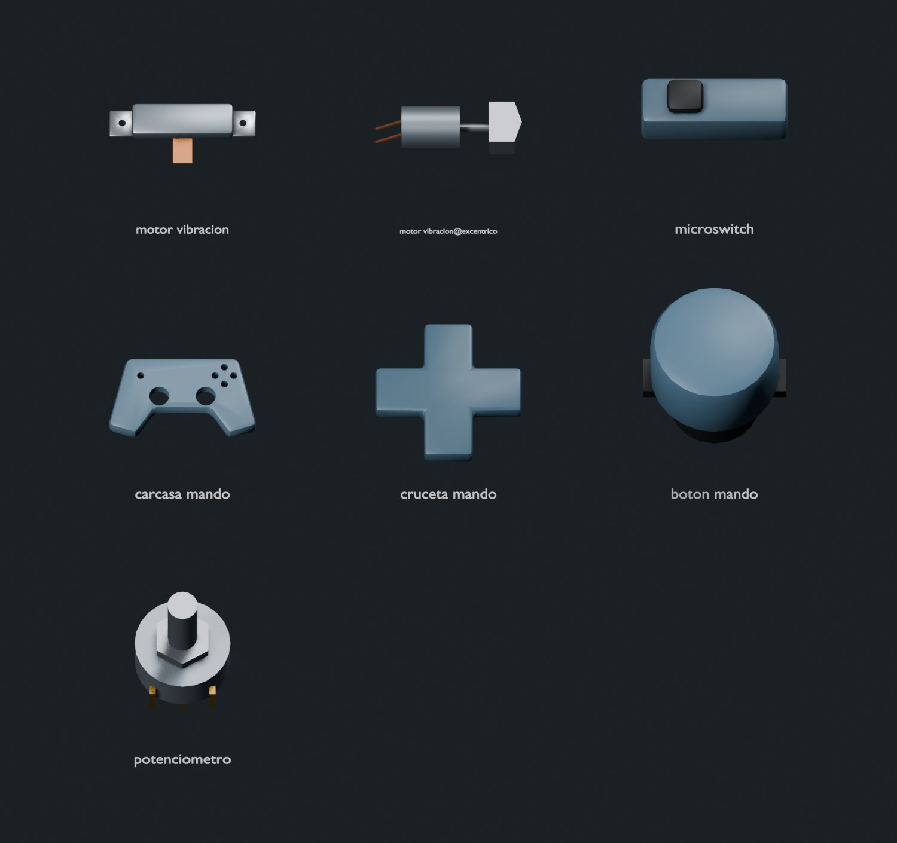

Nuevas:

- [motor_vibracion](renders/facultad/motor_vibracion.jpg) — `proporcional`.
- [motor_vibracion@excentrico](renders/facultad/motor_vibracion@excentrico.jpg) — `proporcional`.
- [microswitch](renders/facultad/microswitch.jpg) — `proporcional`.
- [carcasa_mando](renders/facultad/carcasa_mando.jpg) — `proporcional`.
- [cruceta_mando](renders/facultad/cruceta_mando.jpg) — `proporcional`.
- [boton_mando](renders/facultad/boton_mando.jpg) — `redondo:xz`.
- [potenciometro](renders/facultad/potenciometro.jpg) — `proporcional`.

Reutilizadas: `joystick_analogico`, `boton_gatillo`, `membrana_botones`, `placa`, `bateria@celular`, `conector@usb_c`, `tornillo`.

Actuador lineal o excéntrico según el mando; no implica que ambos estén presentes.

### Parlante de PC

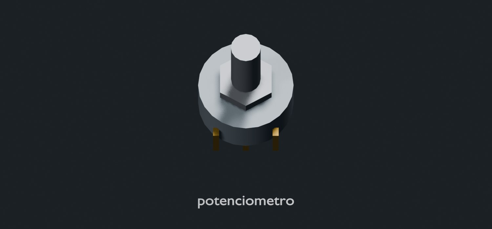

Nuevas:

- [potenciometro](renders/facultad/potenciometro.jpg) — `proporcional`.

Reutilizadas: `parlante`, `malla_acustica`, `fuente`, `placa`, `perilla_mando`, `cable@redondo`, `tornillo`.

Alimentación interna o externa según el equipo; volumen con potenciómetro solo si existe.

### Cargador de notebook

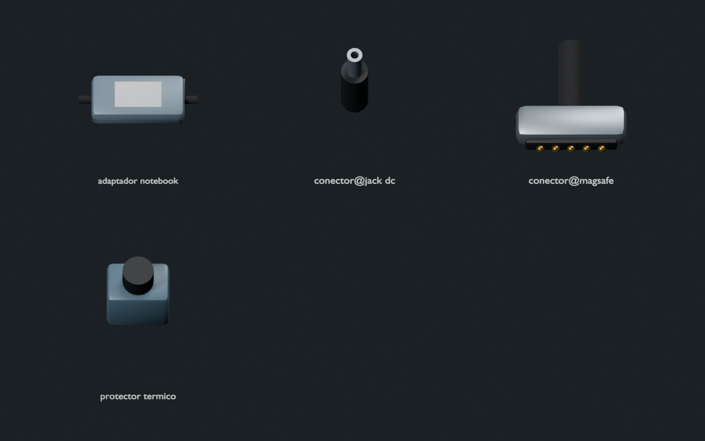

Nuevas:

- [adaptador_notebook](renders/facultad/adaptador_notebook.jpg) — `proporcional`.
- [conector@jack_dc](renders/facultad/conector@jack_dc.jpg) — `proporcional`.
- [conector@magsafe](renders/facultad/conector@magsafe.jpg) — `proporcional`.
- [protector_termico](renders/facultad/protector_termico.jpg) — `proporcional`.

Reutilizadas: `fuente`, `nucleo_ferrita`, `fusible_cartucho`, `conector@usb_c`, `cable@redondo`, `clavija_red`.

USB-C, jack DC y conector magnético son alternativas; no se asignan potencia, polaridad o compatibilidad.

### Zapatilla eléctrica

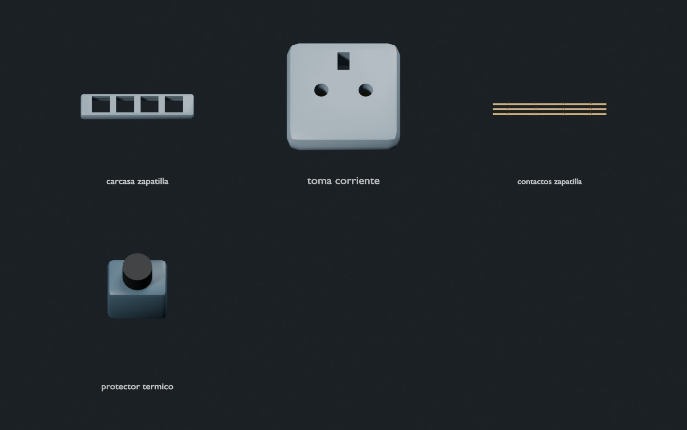

Nuevas:

- [carcasa_zapatilla](renders/facultad/carcasa_zapatilla.jpg) — `proporcional`.
- [toma_corriente](renders/facultad/toma_corriente.jpg) — `proporcional`.
- [contactos_zapatilla](renders/facultad/contactos_zapatilla.jpg) — `proporcional`.
- [protector_termico](renders/facultad/protector_termico.jpg) — `proporcional`.

Reutilizadas: `interruptor_basculante`, `cable@redondo`, `clavija_red`, `tornillo`.

Módulos ilustrativos, sin norma, trazado eléctrico, conexión funcional ni instrucciones de intervención.

